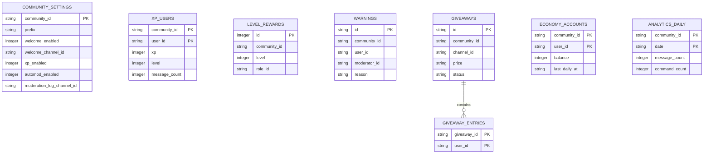

# NEXUS Database & Persistence Architecture

## 1. Persistence Overview

NEXUS uses SQLite 3 for relational, structured persistence, integrated directly with Root's dedicated bot filesystem (`rootServer.dataStore.config.sqlite3.filename`).

### Key Database Guarantees:
- **Write-Ahead Logging (WAL):** `PRAGMA journal_mode = WAL;` enables concurrent reads during active write transactions.
- **Foreign Key Integrity:** `PRAGMA foreign_keys = ON;` guarantees referential integrity across cascading deletions.
- **Root Size Constraints:** Managed within Root's documented 500 MB per-bot database quota.
- **Safe Restart Survival:** All settings, user XP, economy accounts, warning records, and active giveaways persist through bot restarts, container migrations, or host upgrades.

---

## 2. Relational Schema & Tables

---

## 3. Table Definitions

### 3.1 `community_settings`
Stores per-community configuration overrides.
- `community_id` (TEXT, PK): Unique Root community GUID.
- `prefix` (TEXT): Custom command prefix (default `!`).
- `welcome_enabled` (INTEGER): 0 or 1.
- `welcome_channel_id` (TEXT): Target channel for member arrivals.
- `welcome_message` (TEXT): Custom greeting template.
- `auto_role_id` (TEXT): Role GUID to assign to new arrivals.
- `xp_enabled` (INTEGER): Message XP toggle.
- `xp_cooldown_seconds` (INTEGER): Cooldown between XP gains.
- `min_xp_per_message` / `max_xp_per_message` (INTEGER): XP random generation bounds.
- `level_announcements` (INTEGER): Level up announcement toggle.
- `automod_enabled` / `automod_block_links` (INTEGER): Automod toggles.
- `automod_block_words` (TEXT): JSON array of blocked words.
- `automod_spam_threshold` (INTEGER): Maximum messages per 5s before automod action.
- `moderation_log_channel_id` (TEXT): Channel for moderation action dispatches.
- `economy_enabled` (INTEGER): Virtual economy toggle.
- `currency_name` / `currency_symbol` (TEXT): Name and glyph for economy.
- `daily_reward_amount` (INTEGER): Credits awarded daily.
- `updated_at` (TEXT): ISO 8601 timestamp.

### 3.2 `warnings`
Permanent disciplinary warnings history.
- `id` (TEXT, PK): Unique warning identifier (`warn_{timestamp}_{rand}`).
- `community_id` (TEXT): Community scope.
- `user_id` (TEXT): Offender GUID.
- `moderator_id` (TEXT): Issuer GUID.
- `reason` (TEXT): Detailed explanation.
- `created_at` (TEXT): ISO 8601 timestamp.

*Index:* `idx_warnings_user (community_id, user_id)` for sub-millisecond warning history retrieval.

### 3.3 `moderation_logs`
Audit log of all moderation interventions (warnings, kicks, bans, message purges).
- `id` (INTEGER, PK AUTOINCREMENT)
- `community_id`, `action`, `user_id`, `moderator_id`, `reason`, `details`, `created_at`

### 3.4 `xp_users`
User engagement and leveling progress.
- `community_id` (TEXT), `user_id` (TEXT) -> Compound PK.
- `xp` (INTEGER): Total accumulated XP.
- `level` (INTEGER): Current calculated rank tier.
- `message_count` (INTEGER): Lifetime valid messages sent.
- `last_message_at` (TEXT): Timestamp used for cooldown calculations.
- `updated_at` (TEXT).

*Index:* `idx_xp_leaderboard (community_id, level DESC, xp DESC)` for instantaneous top-10 leaderboard rendering.

### 3.5 `level_rewards`
Automated role rewards granted at milestone levels.
- `id` (INTEGER, PK AUTOINCREMENT)
- `community_id` (TEXT), `level` (INTEGER, UNIQUE per community), `role_id` (TEXT), `role_name` (TEXT)

### 3.6 `user_achievements`
Tracks unlocked milestone badges per user.
- `community_id` (TEXT), `user_id` (TEXT), `achievement_id` (TEXT) -> Compound PK.
- `unlocked_at` (TEXT).

### 3.7 `reaction_roles`
Interactive emoji-to-role mappings on specific messages.
- `id` (INTEGER, PK AUTOINCREMENT)
- `community_id` (TEXT), `message_id` (TEXT), `emoji` (TEXT), `role_id` (TEXT), `created_at` (TEXT).
*Index:* `idx_reaction_roles_lookup (community_id, message_id, emoji)` UNIQUE.

### 3.8 `giveaways` & `giveaway_entries`
Scheduled community giveaways with winner tracking.
- `giveaways`: `id` (PK), `community_id`, `channel_id`, `message_id`, `prize`, `winner_count`, `ends_at`, `created_by`, `status` ('active' | 'completed' | 'cancelled'), `winners_json`.
- `giveaway_entries`: `giveaway_id` (FK to giveaways), `user_id` (Compound PK ensures no duplicate entries).

### 3.9 `economy_accounts`
Virtual wallet balances and daily claim timers.
- `community_id` (TEXT), `user_id` (TEXT) -> Compound PK.
- `balance` (INTEGER, NOT NULL DEFAULT 0, CHECK balance >= 0).
- `last_daily_at` (TEXT).
- `created_at`, `updated_at`.

### 3.10 `analytics_daily`
Daily aggregated activity metrics.
- `community_id` (TEXT), `date` (TEXT, YYYY-MM-DD) -> Compound PK.
- `message_count`, `command_count`, `moderation_count`, `member_joins_count`.

---

## 4. Query Performance & Migrations

All schema definitions (`src/database/schema.ts`) are idempotent using `CREATE TABLE IF NOT EXISTS` and `CREATE INDEX IF NOT EXISTS`. Schema execution occurs at boot before any event handling commences.
